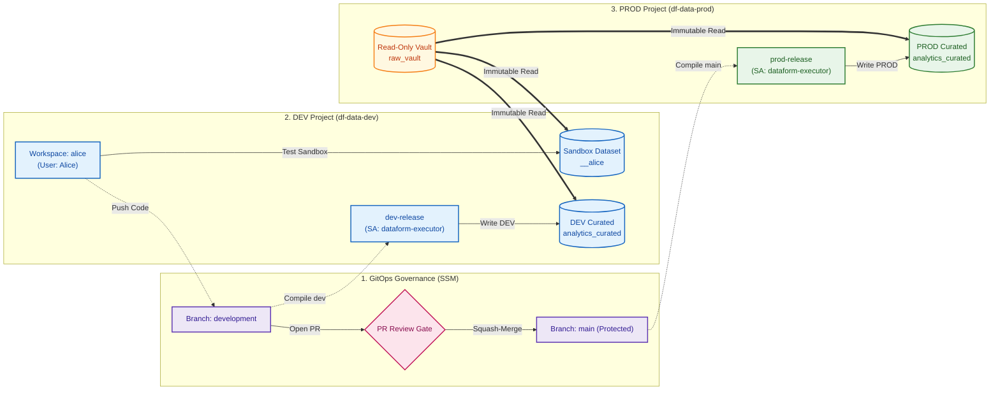

# Google Cloud Dataform Multi-Project ELT & Governance Demo Guide

This guide provides the complete step-by-step walkthrough for demonstrating an enterprise Dataform ELT pipeline across isolated Google Cloud environments, GitOps governance with Secure Source Manager, developer sandbox isolation, and automated service account execution in Production.

---

## 🏗️ Architecture & Environment Topology



### Key Environment Mappings
| Environment Role | Project ID | Dataset / Resource | Notes |
| :--- | :--- | :--- | :--- |
| **Git Repository** | `majestic-energy-353306` | `dataform-pipeline` (SSM) | Private Secure Source Manager repository |
| **Developer Sandbox** | `df-data-dev` | `analytics_curated__alice` | Isolated developer testing sandbox |
| **DEV Integration Target**| `df-data-dev` | `analytics_curated` | Automated DEV release target |
| **PROD Raw Source** | `df-data-prod` | `raw_vault.raw_transactions` | Immutable raw data source |
| **PROD Curated Target** | `df-data-prod` | `analytics_curated` | High-governance production tables |
| **Execution Identity** | `df-data-dev` | `dataform-executor@...` | Dedicated pipeline Service Account |

---

### 👥 Roles & Governance Capabilities Matrix

| Capability / Action | Developer (Alice) | Reviewer / Admin |
| :--- | :---: | :---: |
| **Develop code in Dataform workspace (`alice`)** | ✅ **Allowed** | ❌ Private to Alice |
| **Execute & test in Sandbox (`analytics_curated__alice`)** | ✅ **Allowed** | ✅ Allowed |
| **Read raw data from PROD vault (`df-data-prod.raw_vault`)** | ✅ **Allowed** (Read-Only) | ✅ Allowed (Read-Only) |
| **Push code directly to `development` branch** | ✅ **Allowed** | ✅ Allowed |
| **Push code directly to `main` branch** | 🛑 **Blocked** (Branch Rule) | 🛑 **Blocked** (Branch Rule) |
| **Open Pull Request (`development` $\rightarrow$ `main`)** | ✅ **Allowed** | ✅ Allowed |
| **Approve & Squash-Merge PR into `main`** | 🛑 **Blocked** (Needs Reviewer) | ✅ **Allowed** |
| **Directly write to PROD dataset (`df-data-prod.analytics_curated`)** | 🛑 **No Permission** | 🛑 **No Manual Writes** *(SA only)* |
| **Directly write to shared DEV target (`df-data-dev.analytics_curated`)** | 🛑 **No Permission** *(Sandbox only)* | 🛑 **Managed by Release** |
| **Trigger DEV / PROD Workflow Configurations** | 🛑 **No Permission** | ✅ **Allowed** |
| **Audit BigQuery Jobs (`INFORMATION_SCHEMA`)** | ❌ Limited to own jobs | ✅ Full project audit |

#### Key Governance Boundaries:
* **Developer (Alice)**: Can only modify her private sandbox tables and push to `development`. Cannot write to Production or merge her own PRs.
* **Reviewer / Admin**: Approves PRs and manages release configs. Cannot push unreviewed code directly to `main`.
* **Pipeline Service Account (`dataform-executor`)**: The **only** identity that writes to `df-data-prod.analytics_curated` and `df-data-dev.analytics_curated` during automated release workflows.

---

## 🧹 Phase 0: Pre-Demo Reset (One-Command Cleanup)

Before beginning the demonstration, reset all environments (Git branches, workspaces, DEV/PROD datasets, and sandboxes) back to the pristine **v1.0 baseline**:

```bash
./scripts/12_reset_demo_state.sh
```

### What Gets Reset:
1. **Git Branches**: `development` and `main` branches in Secure Source Manager are reset to commit `d78c0ff` (v1.0 baseline without `customer_tier`).
2. **Developer Workspaces**: Workspace `alice` is freshly cloned and synced with 0 uncommitted changes and 0 conflicts.
3. **BigQuery Environments**:
   - `df-data-dev.analytics_curated` $\rightarrow$ Rebuilt to baseline v1.0 schema.
   - `df-data-prod.analytics_curated` $\rightarrow$ Rebuilt to baseline v1.0 schema.
   - `df-data-dev.analytics_curated__alice` $\rightarrow$ Cleaned and emptied.

---

## 👩‍💻 Step 1: Developer Feature Development (Alice)

### 1.1 Open Workspace & Inspect Sandbox
1. In Google Cloud Console, navigate to **Dataform** in project **`df-data-dev`** (Region: `me-west1`).
2. Open repository **`dataform-pipeline`** $\rightarrow$ Open development workspace **`alice`**.
3. Under **Workspace settings**, observe the Compilation Override:
   - **Schema suffix**: `_alice` (Target dataset: `analytics_curated__alice`).

---

### 1.2 Add the New Business Metric
1. Open [`definitions/outputs/fct_cleaned_transactions.sqlx`](file:///Users/liatsabag/Downloads/DataformDevelopment/definitions/outputs/fct_cleaned_transactions.sqlx).
2. In the `columns: { ... }` documentation block, add:
   ```javascript
   customer_tier: "Customer loyalty tier: PLATINUM (>= $1000), GOLD (>= $500), STANDARD (< $500)",
   ```
3. In the final `SELECT` query, add the tier calculation logic:
   ```sql
   SELECT
     transaction_id,
     customer_id,
     transaction_date,
     transaction_timestamp,
     transaction_amount,
     payment_status,
     (transaction_amount >= 1000.0) AS is_high_value,
     CASE
       WHEN transaction_amount >= 1000.0 THEN 'PLATINUM'
       WHEN transaction_amount >= 500.0 THEN 'GOLD'
       ELSE 'STANDARD'
     END AS customer_tier,
     CURRENT_TIMESTAMP() AS processed_at
   FROM
     deduplicated
   WHERE
     row_num = 1
   ```

---

### 1.3 Test in Developer Sandbox
1. Click **Start execution** in the top bar $\rightarrow$ Select **All actions** (or check *Execute with dependencies*).
2. Once complete, switch to the **BigQuery Console** and run these comparison queries:

#### 🔍 Proof 1.1: Sandbox Table Contains New Metric
```sql
SELECT transaction_id, customer_id, transaction_amount, customer_tier 
FROM `df-data-dev.analytics_curated__alice.fct_cleaned_transactions` 
LIMIT 5;
```
> **Observation**: The `customer_tier` column is populated with `PLATINUM`, `GOLD`, and `STANDARD` values in Alice's sandbox.

#### 🔍 Proof 1.2: Production & DEV Base Tables Remain Untouched
```sql
SELECT * 
FROM `df-data-prod.analytics_curated.fct_cleaned_transactions` 
LIMIT 1;
```
> **Observation**: The production table does **not** contain `customer_tier`. Developer changes are 100% isolated.

---

### 1.4 Commit and Push Code to Git
1. In the Dataform top navigation bar, click **Commit**.
2. Enter commit message: `feat: add customer_tier metric`.
3. Click **Push** to send the commit to Secure Source Manager on the `development` branch.

---

## 🛡️ Step 2: Governance & Pull Request Review (Admin)

### 2.1 Open Pull Request as Alice
1. Navigate to the **[Secure Source Manager Web UI](https://df-source-instance-760763010051.me-west1.sourcemanager.dev/majestic-energy-353306/dataform-pipeline)**.
2. Go to **Pull requests** $\rightarrow$ Click **New pull request**.
3. Configure the branch comparison:
   - **Base branch**: `main`
   - **Compare branch**: `development`
4. Set Title: `feat: add customer_tier metric` $\rightarrow$ Click **Create pull request**.

---

### 2.2 Review and Approve as Admin
1. Log into Secure Source Manager as the Reviewer / Admin (`admin@liatsabag.altostrat.com`).
2. Open the newly created Pull Request.
3. Click the **Files changed** tab:
   - Point out the exact SQL diff (`+ customer_tier` calculation).
4. Click **Review changes** $\rightarrow$ Select **Approve** $\rightarrow$ **Submit review**.
5. Click **Squash and merge** $\rightarrow$ **Confirm merge**.

> 💡 **Governance Proof Point**: The `main` branch enforces branch protection (`requirePullRequest: true`, `minimumApprovalsCount: 1`, `requireLinearHistory: true`). Direct pushes to `main` are strictly blocked.

---

## 🚀 Step 3: Production Release & Execution

### 3.1 Inspect Release Configuration (`prod-release`)
1. In Google Cloud Console, open **Dataform** in `df-data-dev`.
2. In the left navigation, click **Release configurations** $\rightarrow$ Click **`prod-release`**.
3. Highlight the configuration overrides:
   - **Git Commitish**: `main` *(fetches latest merged code)*
   - **Default Database**: `df-data-prod` *(compiles table targets to Production)*

---

### 3.2 Trigger Production Compilation & Execution
1. Click **Create compilation result** (or observe the scheduled 4-hour cron).
2. Go to **Workflow configurations** in the left menu $\rightarrow$ Click **`prod-execution`**.
3. Click **Execute** (or select the compilation result and click **Start execution**).
4. Monitor the workflow graph as all actions turn green (**`SUCCEEDED`**).

---

## 📋 Step 4: Enterprise Audit & Security Verification

To conclude the demonstration, present the **4 Enterprise Verification Proofs**:

---

### 🔍 Proof 1: Business Feature Deployed to Production
Query the production fact table in BigQuery:

```sql
SELECT transaction_id, customer_id, transaction_amount, customer_tier, processed_at
FROM `df-data-prod.analytics_curated.fct_cleaned_transactions`
LIMIT 5;
```

| `transaction_id` | `customer_id` | `transaction_amount` | `customer_tier` | `processed_at` |
| :--- | :--- | :--- | :--- | :--- |
| `TXN-001` | `CUST-101` | `1250.00` | **`PLATINUM`** | `2026-10-12 17:15:00 UTC` |
| `TXN-002` | `CUST-205` | `650.00` | **`GOLD`** | `2026-10-12 17:15:00 UTC` |
| `TXN-003` | `CUST-089` | `120.00` | **`STANDARD`** | `2026-10-12 17:15:00 UTC` |

---

### 🔍 Proof 2: Service Account Execution (Zero Human Touch in PROD)
Verify who executed the queries in BigQuery using `INFORMATION_SCHEMA.JOBS_BY_PROJECT`:

```sql
SELECT job_id, user_email, creation_time, query 
FROM `region-me-west1.INFORMATION_SCHEMA.JOBS_BY_PROJECT`
WHERE query LIKE '%df-data-prod.analytics_curated.fct_cleaned_transactions%'
ORDER BY creation_time DESC 
LIMIT 1;
```

#### Verification Result:
- **`user_email`**: **`dataform-executor@df-data-dev.iam.gserviceaccount.com`**
- **Audit Meaning**: Proves that neither Alice nor Admin accessed production data directly; the execution was performed exclusively by the least-privilege Dataform Service Account.

---

### 🔍 Proof 3: Source Project Immutability Across All Releases
Verify that the source project `vars.source_project` remained locked to `df-data-prod.raw_vault`:

1. **In Git ([`workflow_settings.yaml`](file:///Users/liatsabag/Downloads/DataformDevelopment/workflow_settings.yaml))**:
   ```yaml
   defaultProject: df-data-dev
   defaultDataset: analytics_curated
   defaultLocation: me-west1
   vars:
     source_project: df-data-prod
     source_dataset: raw_vault
   ```
2. **In BigQuery Executed Query Text**:
   ```sql
   SELECT query 
   FROM `region-me-west1.INFORMATION_SCHEMA.JOBS_BY_PROJECT`
   WHERE query LIKE '%stg_transactions%'
   ORDER BY creation_time DESC 
   LIMIT 1;
   ```
   *Query shows*:
   ```sql
   FROM `df-data-prod.raw_vault.raw_transactions`
   ```

---

### 🔍 Proof 4: Lineage & Dependency Graph
In Google Cloud Console $\rightarrow$ **Dataform** $\rightarrow$ Compilation Results:
- Open the compiled DAG view.
- Highlight the source declaration node: **`df-data-prod.raw_vault.raw_transactions`** flowing through **`stg_transactions`** into **`df-data-prod.analytics_curated.fct_cleaned_transactions`** and the quality assertions (**`assert_unique_transaction_id`**, **`assert_positive_transaction_amount`**).

---

## 🎯 Demonstration Summary Matrix

| Evaluation Criteria | Developer Sandbox | DEV Release | PROD Release |
| :--- | :--- | :--- | :--- |
| **Executing Identity** | `alice@liatsabag...` | `dataform-executor@...` | `dataform-executor@...` |
| **Source Project & Dataset** | `df-data-prod.raw_vault` | `df-data-prod.raw_vault` | `df-data-prod.raw_vault` |
| **Target Project & Dataset** | `df-data-dev.analytics_curated__alice` | `df-data-dev.analytics_curated` | `df-data-prod.analytics_curated` |
| **Governance Gate** | Private Sandbox | Git `development` branch | Branch Protection on `main` + PR Review |
