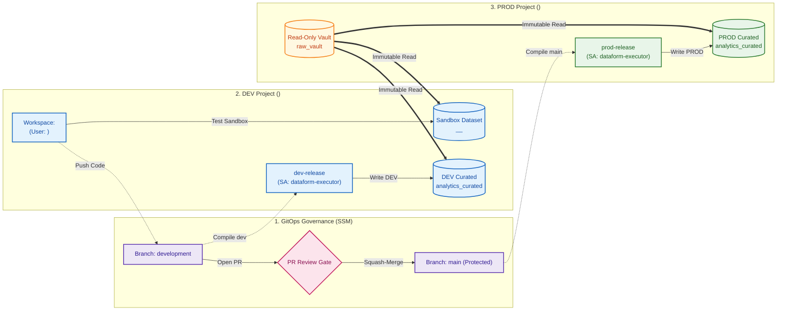

# Enterprise Dataform Multi-Project ELT & Governance: Demo Script & Presentation Guide

This document is the official presenter guide and demo script for demonstrating multi-project Dataform ELT architecture, Secure Source Manager GitOps governance, developer sandbox isolation, and automated execution under Google Cloud Service Accounts in both DEV and PROD environments.

---

## 📑 Agenda & Presentation Flow

- [🏛️ Architecture & Governance Overview](#%EF%B8%8F-architecture--governance-overview)
- [🧹 Phase 0: Pre-Demo Baseline Reset](#-phase-0-pre-demo-baseline-reset)
- [👩‍💻 Step 1: Feature Development & Sandbox Isolation](#-step-1-feature-development--sandbox-isolation)
- [⚙️ Step 2: DEV Integration Release & Automated Execution](#%EF%B8%8F-step-2-dev-integration-release--automated-execution)
- [🛡️ Step 3: GitOps Governance & Peer Review (SSM)](#%EF%B8%8F-step-3-gitops-governance--peer-review-ssm)
- [🚀 Step 4: Production Release Compilation & Execution](#-step-4-production-release-compilation--execution)
- [📋 Step 5: Enterprise Audit & Security Verification](#-step-5-enterprise-audit--security-verification)
- [📊 Summary Scorecard](#-summary-scorecard)
- [👥 Appendix: Enterprise Roles & Governance Matrix](#-enterprise-roles--governance-matrix-appendix)

---

## 🏛️ Architecture & Governance Overview



### Environment Topology
* **SSM Project (`<ssm_project_id>`)**: Hosts the central `dataform-pipeline` Git repository with branch protections on `main`.
* **DEV Project (`<dev_project_id>`)**: Contains developer workspaces (`workspaces/<developer_workspace>`), private sandboxes (`analytics_curated__<developer_workspace>`), and DEV release execution.
* **PROD Project (`<prod_project_id>`)**: Holds immutable source tables (`raw_vault.raw_transactions`) and target production datasets (`analytics_curated`).

> 💡 *For the complete permissions and actor capabilities breakdown, see the [Enterprise Roles & Governance Matrix](#-enterprise-roles--governance-matrix-appendix) at the bottom.*

---

## 🧹 Phase 0: Pre-Demo Baseline Reset

> *Run this command prior to presenting to ensure all environments, branches, and tables are restored to v1.0 baseline.*

```bash
./scripts/12_reset_demo_state.sh
```

**Verified Reset State:**
* Git branches `development` and `main` reset to baseline commit.
* Workspace `<developer_workspace>` re-cloned clean with zero conflicts.
* `<dev_project_id>.analytics_curated` & `<prod_project_id>.analytics_curated` reset to baseline (0 `customer_tier` columns).
* Developer sandbox `analytics_curated__<developer_workspace>` wiped clean.

---

## 👩‍💻 Step 1: Feature Development & Sandbox Isolation

### 🎯 Objective
Show how a developer writes SQLX transformation logic and safely tests it inside an isolated sandbox dataset without affecting shared DEV or PROD tables.

---

### 🎙️ Presenter Script (What to Say)
> *"We begin our journey from the developer's perspective. Here, developer is tasked with adding a new business metric—`customer_tier`—which categorizes transactions into PLATINUM, GOLD, and STANDARD.*
>
> *Notice that the developer is working inside their dedicated Dataform development workspace `<developer_workspace>`. In their workspace settings, they have a schema suffix override configured as `_<developer_workspace>`.*
>
> *When code is executed, Dataform automatically redirects all table creation into the isolated sandbox dataset `<dev_project_id>.analytics_curated__<developer_workspace>`. They can test, iterate, and validate with zero risk of overwriting shared development data or production pipelines."*

---

### 🖱️ Action Steps (What to Do)
1. In Google Cloud Console, navigate to **Dataform** in project **`<dev_project_id>`** (Region: `<region>`).
2. Open repository **`dataform-pipeline`** $\rightarrow$ Click workspace **`<developer_workspace>`**.
3. Open [`definitions/outputs/fct_cleaned_transactions.sqlx`](definitions/outputs/fct_cleaned_transactions.sqlx).
4. In the `columns: { ... }` block, add the documentation:
   ```javascript
   customer_tier: "Customer loyalty tier: PLATINUM (>= $1000), GOLD (>= $500), STANDARD (< $500)",
   ```
5. In the `SELECT` query, add the tier calculation:
   ```sql
   SELECT
     transaction_id,
     customer_id,
     transaction_date,
     transaction_timestamp,
     transaction_amount,
     payment_status,
     (transaction_amount >= 1000.0) AS is_high_value,
     CASE
       WHEN transaction_amount >= 1000.0 THEN 'PLATINUM'
       WHEN transaction_amount >= 500.0 THEN 'GOLD'
       ELSE 'STANDARD'
     END AS customer_tier,
     CURRENT_TIMESTAMP() AS processed_at
   FROM
     deduplicated
   WHERE
     row_num = 1
   ```
6. In the top navigation bar, click **Start execution** $\rightarrow$ Select **All actions**.
7. Once execution finishes, open the **BigQuery Console** and run the sandbox verification query:
   ```sql
   SELECT transaction_id, customer_id, transaction_amount, customer_tier 
   FROM `<dev_project_id>.analytics_curated__<developer_workspace>.fct_cleaned_transactions` 
   LIMIT 5;
   ```
8. Also show that the production table remains untouched:
   ```sql
   SELECT * 
   FROM `<prod_project_id>.analytics_curated.fct_cleaned_transactions` 
   LIMIT 1;
   ```
9. Return to Dataform workspace `<developer_workspace>` $\rightarrow$ Click **Commit** $\rightarrow$ Enter message: `feat: add customer_tier metric` $\rightarrow$ Click **Push** to `development`.

---

### 🖥️ Screen Presentation (What to Show)
1. **Target Screen / Tab**: Open **BigQuery Studio** in project **`<dev_project_id>`**.
2. **What to Point to on Screen**:
   - In the left Explorer pane, expand `<dev_project_id>` $\rightarrow$ dataset `analytics_curated__<developer_workspace>`.
   - In the Query Results grid for `fct_cleaned_transactions`, point out the new `customer_tier` column populated with `PLATINUM`, `GOLD`, and `STANDARD`.
   - In an adjacent query tab, show that the production table (`<prod_project_id>.analytics_curated`) does not have this column yet.
3. **Key Takeaway to Deliver**:
   > *"The developer is completely isolated in their private sandbox dataset, proving full freedom to develop and test without any risk of polluting production or shared integration environments."*

---

## ⚙️ Step 2: DEV Integration Release & Automated Execution

### 🎯 Objective
Demonstrate how pushed code on the `development` branch is automatically compiled and executed into the shared DEV integration dataset (`<dev_project_id>.analytics_curated`) by the dedicated Service Account.

---

### 🎙️ Presenter Script (What to Say)
> *"Once the developer pushes code to the `development` branch, our DEV integration pipeline takes over.*
>
> *In Dataform, our `dev-release` configuration tracks the `development` branch and compiles code targeting the shared development dataset `<dev_project_id>.analytics_curated`.*
>
> *While in production this runs automatically on a scheduled cron (or via a CI/CD trigger), for our demo we can trigger an on-demand compilation of `dev-release` right now.*
>
> *When we execute `dev-execution`, notice that the pipeline does not run as an individual developer. It runs under our dedicated Service Account: `dataform-executor`. This proves that our shared development tables are updated by automated pipelines under least-privilege service identities rather than individual user accounts."*

---

### 🖱️ Action Steps (What to Do)
1. In Google Cloud Console, open **Dataform** in project **`<dev_project_id>`**.
2. Go to **Release configurations** $\rightarrow$ Click **`dev-release`**.
3. Point out settings:
   - **Git Commitish**: `development`
   - **Target Database**: `<dev_project_id>`
4. Click **Create compilation result**.
5. Go to **Workflow configurations** $\rightarrow$ Click **`dev-execution`** $\rightarrow$ Click **Execute**.
6. Switch to **BigQuery Console** and query the shared DEV integration table:
   ```sql
   SELECT transaction_id, customer_id, customer_tier 
   FROM `<dev_project_id>.analytics_curated.fct_cleaned_transactions` 
   LIMIT 5;
   ```
   *(Shows `customer_tier` is now live in shared DEV integration table).*

---

### 🖥️ Screen Presentation (What to Show)
1. **Target Screen / Tab**: Open **Dataform Console** in project **`<dev_project_id>`** $\rightarrow$ **Workflow Invocations** $\rightarrow$ **`dev-execution`**.
2. **What to Point to on Screen**:
   - Highlight the green **SUCCEEDED** status banner and target database `<dev_project_id>`.
   - Point out the execution service account identity: `dataform-executor@<dev_project_id>.iam.gserviceaccount.com`.
   - Switch to BigQuery Studio and show query results confirming `customer_tier` is now updated in shared DEV (`<dev_project_id>.analytics_curated`).
3. **Key Takeaway to Deliver**:
   > *"The shared development integration dataset was updated entirely through an automated Dataform release pipeline under a dedicated service account identity, not a human credential."*

---

## 🛡️ Step 3: GitOps Governance & Peer Review (SSM)

### 🎯 Objective
Demonstrate enterprise GitOps controls: branch protection on `main`, mandatory peer review, automated diff inspection, and squash-merging in Secure Source Manager.

---

### 🎙️ Presenter Script (What to Say)
> *"With the feature validated in DEV, the developer is ready to promote code to Production by opening a Pull Request into `main`.*
>
> *Under our enterprise governance policies, no developer can push directly to `main`. The `main` branch is protected by strict branch rules requiring at least one approved code review, resolved comment threads, and linear commit history.*
>
> *As the Admin and Data Lead, I open Secure Source Manager to review the Pull Request. I inspect the SQL diff, verify business logic against modeling standards, approve the PR, and perform a Squash and Merge into `main`."*

---

### 🖱️ Action Steps (What to Do)
1. Open the **Secure Source Manager Web UI**:
   `https://<instance_id>-<project_number>.<region>.sourcemanager.dev/<ssm_project_id>/<repo_id>`
2. In repository **`dataform-pipeline`**, go to **Pull requests** $\rightarrow$ Click **New pull request**.
3. Configure PR:
   - **Base**: `main`
   - **Compare**: `development`
   - **Title**: `feat: add customer_tier metric` $\rightarrow$ Click **Create pull request**.
4. Switch to Admin account (`<admin_email>`) $\rightarrow$ Open the PR.
5. Click the **Files changed** tab:
   - Highlight the green diff showing `+ customer_tier`.
6. Click **Review changes** $\rightarrow$ Choose **Approve** $\rightarrow$ Click **Submit review**.
7. In the overview tab, select **Squash and merge** $\rightarrow$ Click **Confirm merge**.

---

### 🖥️ Screen Presentation (What to Show)
1. **Target Screen / Tab**: Open **Secure Source Manager Web UI** in project **`<ssm_project_id>`** $\rightarrow$ Repository **`dataform-pipeline`** $\rightarrow$ **Pull requests**.
2. **What to Point to on Screen**:
   - Point out the PR branch route: Base `main` $\leftarrow$ Compare `development`.
   - Open the **Files changed** tab and highlight the green diff adding the `customer_tier` calculation.
   - Point to the branch protection policy checklist showing that merge is blocked until an authorized reviewer approves.
   - After approving, show the green **Approved** badge, click **Squash and merge**, and point to the closed PR banner.
3. **Key Takeaway to Deliver**:
   > *"No code reaches production without formal peer review. Secure Source Manager strictly enforces branch protection, preventing direct pushes to main and ensuring full GitOps compliance."*

---

## 🚀 Step 4: Production Release Compilation & Execution

### 🎯 Objective
Demonstrate how Dataform compiles the merged `main` branch targeting the Production environment (`<prod_project_id>`) and executes the release using the dedicated Service Account.

---

### 🎙️ Presenter Script (What to Say)
> *"With the PR merged into `main`, we trigger our production release pipeline.*
>
> *In Dataform, our `prod-release` configuration is bound to the `main` branch with a database compilation override set to `<prod_project_id>`.*
>
> *When we compile and trigger the `prod-execution` workflow, Dataform executes the DAG against `<prod_project_id>`. Notice that all transformations run under our least-privilege service account: `dataform-executor`. Zero human credentials are used in production."*

---

### 🖱️ Action Steps (What to Do)
1. In Google Cloud Console, open **Dataform** in project **`<dev_project_id>`**.
2. In the left navigation, click **Release configurations** $\rightarrow$ Click **`prod-release`**.
3. Point out the settings:
   - **Git Commitish**: `main`
   - **Default Database Override**: `<prod_project_id>`
4. Click **Create compilation result**.
5. In the left navigation, click **Workflow configurations** $\rightarrow$ Click **`prod-execution`**.
6. Click **Execute** (or select the newly created compilation result and click **Start execution**).
7. Watch the Workflow Invocation DAG view as all actions execute and turn green (**`SUCCEEDED`**).

---

### 🖥️ Screen Presentation (What to Show)
1. **Target Screen / Tab**: Open **Dataform Console** in project **`<dev_project_id>`** $\rightarrow$ **Workflow Invocations** $\rightarrow$ **`prod-execution`**.
2. **What to Point to on Screen**:
   - Highlight the green **SUCCEEDED** status banner and target database `<prod_project_id>`.
   - Point to the live compilation DAG showing all green checkmarks across views, tables, and assertions (`stg_transactions`, `fct_cleaned_transactions`, `assert_unique_transaction_id`, `assert_positive_transaction_amount`).
   - Highlight the execution identity: `dataform-executor@<dev_project_id>.iam.gserviceaccount.com`.
3. **Key Takeaway to Deliver**:
   > *"The production release compiled from the approved main branch and executed cleanly with 100% automated quality assertions passing, without any human credentials touching production."*

---

## 📋 Step 5: Enterprise Audit & Security Verification

### 🎯 Objective
Provide mathematical and cryptographic proof of feature delivery, zero human access, source immutability, and end-to-end data lineage in BigQuery.

---

### 🎙️ Presenter Script (What to Say)
> *"To conclude our demonstration, we present our four enterprise verification proofs.*
>
> *First, we query our Production BigQuery table. As you can see, `customer_tier` is now live and populated with validated PLATINUM, GOLD, and STANDARD tiers.*
>
> *Second, we query BigQuery's `INFORMATION_SCHEMA.JOBS_BY_PROJECT` audit table. This proves conclusively that the query was executed exclusively by `dataform-executor@<dev_project_id>.iam.gserviceaccount.com`, guaranteeing zero human access to production data.*
>
> *Third, our Infrastructure-as-Code settings prove that our source raw vault `<prod_project_id>.raw_vault` remained completely immutable across all environments.*
>
> *This confirms a complete, compliant, and secure multi-project ELT architecture."*

---

### 🖱️ Action Steps (What to Do)
1. In BigQuery Console, run the **Production Data Verification Query**:
   ```sql
   SELECT transaction_id, customer_id, transaction_amount, customer_tier, processed_at
   FROM `<prod_project_id>.analytics_curated.fct_cleaned_transactions`
   ORDER BY transaction_amount DESC
   LIMIT 5;
   ```
2. Run the **Service Account Execution Audit Query**:
   ```sql
   SELECT 
     job_id, 
     user_email, 
     creation_time, 
     total_bytes_processed,
     query
   FROM `region-<region>.INFORMATION_SCHEMA.JOBS_BY_PROJECT`
   WHERE query LIKE '%<prod_project_id>.analytics_curated.fct_cleaned_transactions%'
   ORDER BY creation_time DESC 
   LIMIT 1;
   ```
3. Highlight the `user_email` column: `dataform-executor@<dev_project_id>.iam.gserviceaccount.com`.
4. Run the **Source Immutability Query**:
   ```sql
   SELECT query 
   FROM `region-<region>.INFORMATION_SCHEMA.JOBS_BY_PROJECT`
   WHERE query LIKE '%stg_transactions%'
   ORDER BY creation_time DESC 
   LIMIT 1;
   ```
   *(Show `FROM \`<prod_project_id>.raw_vault.raw_transactions\``)*.

---

### 🖥️ Screen Presentation (What to Show)
1. **Target Screen / Tab**: Open **BigQuery Studio** in project **`<prod_project_id>`**.
2. **What to Point to on Screen**:
   - In the Production Data verification query results, point out that `customer_tier` is live and populated with `PLATINUM`, `GOLD`, and `STANDARD` values.
   - In the `INFORMATION_SCHEMA.JOBS_BY_PROJECT` query results, point to the `user_email` column explicitly showing `dataform-executor@<dev_project_id>.iam.gserviceaccount.com`.
   - In the Source Immutability query results, point to the SQL statement reading strictly from `<prod_project_id>.raw_vault.raw_transactions`.
3. **Key Takeaway to Deliver**:
   > *"We have end-to-end cryptographic and audit log proof: production business data was successfully updated, zero human credentials accessed production, and raw source data remained 100% immutable throughout the entire lifecycle."*

---

## 📊 Summary Scorecard

| Requirement | Demonstrated Capability | Verified Evidence |
| :--- | :--- | :--- |
| **Multi-Project Isolation** | DEV, PROD, and Code hosted in separate projects | BigQuery datasets & IAM boundary logs |
| **Developer Sandboxes** | Isolated development per user | `analytics_curated__<developer_workspace>` dataset |
| **DEV Release Integration** | Automated execution of `development` branch | `dev-release` $\rightarrow$ `<dev_project_id>.analytics_curated` |
| **GitOps & PR Governance** | Protected `main` branch with mandatory review | SSM Pull Request approval record |
| **Zero Human Touch** | Least-privilege automated execution in DEV & PROD | BigQuery `user_email: dataform-executor@...` |
| **Source Immutability** | Read-only raw vault across all environments | `vars.source_project: <prod_project_id>` |
| **Quality Assertions** | Automated unique key and value constraints | Green assertion nodes in compiled DAG |

---

## 👥 Enterprise Roles & Governance Matrix (Appendix)

| Capability / Action | Developer (`<developer_email>`) | Reviewer / Admin | Pipeline Service Account |
| :--- | :--- | :--- | :--- |
| **Workspace Development** (`workspaces/<developer_workspace>`) | Allowed | Denied *(Isolated per user)* | N/A |
| **Sandbox Execution** (`analytics_curated__<developer_workspace>`) | Allowed | Allowed | N/A |
| **Raw Data Access** (`raw_vault`) | Allowed *(Read-Only)* | Allowed *(Read-Only)* | Allowed *(Read-Only)* |
| **Push to Development Branch** (`development`) | Allowed | Allowed | N/A |
| **Push to Main Branch** (`main`) | Blocked *(Branch Protection)* | Blocked *(Branch Protection)* | N/A |
| **Open Pull Request** (`development` &rarr; `main`) | Allowed | Allowed | N/A |
| **Approve & Merge Pull Request** | Blocked *(Peer Review Required)* | Allowed | N/A |
| **Direct Write to Production** (`analytics_curated`) | Denied | Denied *(Service Account Only)* | Allowed *(Automated)* |
| **Direct Write to Shared DEV** (`analytics_curated`) | Denied *(Sandbox Only)* | Denied *(Release Managed)* | Allowed *(Automated)* |
| **Trigger Release Workflows** (`dev-release` / `prod-release`) | Denied | Allowed | Execution Identity |
| **Audit BigQuery Jobs** (`INFORMATION_SCHEMA`) | Self Only | Full Project Audit | Logged Principal |

#### Key Governance Boundaries:
* **Developer Persona**: Confined to private sandbox datasets and feature branches. Cannot write to production or self-approve PRs.
* **Reviewer / Admin**: Reviews code diffs, enforces quality gates, and triggers release pipelines. Cannot bypass peer reviews.
* **Pipeline Service Account (`dataform-executor`)**: The exclusive identity authorized to write to shared DEV and PROD datasets during automated workflow executions.
