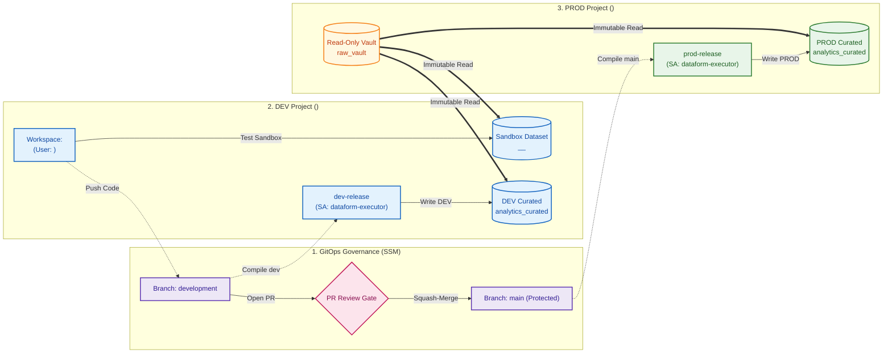

# Enterprise Dataform Multi-Project ELT & Governance: Demo Script & Presentation Guide

This document is the official presenter guide and demo script for demonstrating multi-project Dataform ELT architecture, Secure Source Manager GitOps governance, developer sandbox isolation, and automated execution under Google Cloud Service Accounts in both DEV and PROD environments.

---

## 🏛️ Architecture & Governance Overview



### Environment Topology
| Component | Project ID | Location / Resource | Governance Purpose |
| :--- | :--- | :--- | :--- |
| **Git Repository** | `<ssm_project_id>` | SSM `dataform-pipeline` | Single source of truth with protected branches |
| **Developer Sandbox** | `<dev_project_id>` | `analytics_curated__<developer_workspace>` | Private dataset for developer isolated testing |
| **DEV Integration Target**| `<dev_project_id>` | `analytics_curated` | Automated integration environment |
| **PROD Raw Source** | `<prod_project_id>` | `raw_vault.raw_transactions` | Immutable, read-only enterprise data vault |
| **PROD Target** | `<prod_project_id>` | `analytics_curated` | High-governance production tables |
| **Execution Identity** | `<dev_project_id>` | `dataform-executor@...` | Least-privilege pipeline Service Account |

---

### 👥 Roles & Governance Capabilities Matrix

| Capability / Action | Developer (<developer_email>) | Reviewer / Admin |
| :--- | :---: | :---: |
| **Develop code in Dataform workspace (`<developer_workspace>`)** | ✅ **Allowed** | ❌ User-Isolated |
| **Execute & test in Sandbox (`analytics_curated__<developer_workspace>`)** | ✅ **Allowed** | ✅ Allowed |
| **Read raw data from PROD vault (`<prod_project_id>.raw_vault`)** | ✅ **Allowed** (Read-Only) | ✅ Allowed (Read-Only) |
| **Push code directly to `development` branch** | ✅ **Allowed** | ✅ Allowed |
| **Push code directly to `main` branch** | 🛑 **Blocked** (Branch Rule) | 🛑 **Blocked** (Branch Rule) |
| **Open Pull Request (`development` $\rightarrow$ `main`)** | ✅ **Allowed** | ✅ Allowed |
| **Approve & Squash-Merge PR into `main`** | 🛑 **Blocked** (Needs Reviewer) | ✅ **Allowed** |
| **Directly write to PROD dataset (`<prod_project_id>.analytics_curated`)** | 🛑 **No Permission** | 🛑 **No Manual Writes** *(SA only)* |
| **Directly write to shared DEV target (`<dev_project_id>.analytics_curated`)** | 🛑 **No Permission** *(Sandbox only)* | 🛑 **Managed by Release** |
| **Trigger DEV / PROD Workflow Configurations** | 🛑 **No Permission** | ✅ **Allowed** |
| **Audit BigQuery Jobs (`INFORMATION_SCHEMA`)** | ❌ Limited to own jobs | ✅ Full project audit |

#### Key Governance Boundaries:
* **Developer**: Can only modify private sandbox tables and push to `development`. Cannot write to Production or merge own PRs.
* **Reviewer / Admin**: Approves PRs and manages release configs. Cannot push unreviewed code directly to `main`.
* **Pipeline Service Account (`dataform-executor`)**: The **only** identity that writes to `<prod_project_id>.analytics_curated` and `<dev_project_id>.analytics_curated` during automated release workflows.

---

## 🧹 Phase 0: Pre-Demo Baseline Reset

> *Run this command prior to presenting to ensure all environments, branches, and tables are restored to v1.0 baseline.*

```bash
./scripts/12_reset_demo_state.sh
```

**Verified Reset State:**
* Git branches `development` and `main` reset to baseline commit.
* Workspace `<developer_workspace>` re-cloned clean with zero conflicts.
* `<dev_project_id>.analytics_curated` & `<prod_project_id>.analytics_curated` reset to baseline (0 `customer_tier` columns).
* Developer sandbox `analytics_curated__<developer_workspace>` wiped clean.

---

## 👩‍💻 Step 1: Feature Development & Sandbox Isolation

### 🎯 Objective
Show how a developer writes SQLX transformation logic and safely tests it inside an isolated sandbox dataset without affecting shared DEV or PROD tables.

---

### 🎙️ Presenter Script (What to Say)
> *"We begin our journey from the developer's perspective. Here, developer is tasked with adding a new business metric—`customer_tier`—which categorizes transactions into PLATINUM, GOLD, and STANDARD.*
>
> *Notice that the developer is working inside their dedicated Dataform development workspace `<developer_workspace>`. In their workspace settings, they have a schema suffix override configured as `_<developer_workspace>`.*
>
> *When code is executed, Dataform automatically redirects all table creation into the isolated sandbox dataset `<dev_project_id>.analytics_curated__<developer_workspace>`. They can test, iterate, and validate with zero risk of overwriting shared development data or production pipelines."*

---

### 🖱️ Action Steps (What to Do)
1. In Google Cloud Console, navigate to **Dataform** in project **`<dev_project_id>`** (Region: `<region>`).
2. Open repository **`dataform-pipeline`** $\rightarrow$ Click workspace **`<developer_workspace>`**.
3. Open [`definitions/outputs/fct_cleaned_transactions.sqlx`](definitions/outputs/fct_cleaned_transactions.sqlx).
4. In the `columns: { ... }` block, add the documentation:
   ```javascript
   customer_tier: "Customer loyalty tier: PLATINUM (>= $1000), GOLD (>= $500), STANDARD (< $500)",
   ```
5. In the `SELECT` query, add the tier calculation:
   ```sql
   SELECT
     transaction_id,
     customer_id,
     transaction_date,
     transaction_timestamp,
     transaction_amount,
     payment_status,
     (transaction_amount >= 1000.0) AS is_high_value,
     CASE
       WHEN transaction_amount >= 1000.0 THEN 'PLATINUM'
       WHEN transaction_amount >= 500.0 THEN 'GOLD'
       ELSE 'STANDARD'
     END AS customer_tier,
     CURRENT_TIMESTAMP() AS processed_at
   FROM
     deduplicated
   WHERE
     row_num = 1
   ```
6. In the top navigation bar, click **Start execution** $\rightarrow$ Select **All actions**.
7. Once execution finishes, open the **BigQuery Console** and run the sandbox verification query:
   ```sql
   SELECT transaction_id, customer_id, transaction_amount, customer_tier 
   FROM `<dev_project_id>.analytics_curated__<developer_workspace>.fct_cleaned_transactions` 
   LIMIT 5;
   ```
8. Also show that the production table remains untouched:
   ```sql
   SELECT * 
   FROM `<prod_project_id>.analytics_curated.fct_cleaned_transactions` 
   LIMIT 1;
   ```
9. Return to Dataform workspace `<developer_workspace>` $\rightarrow$ Click **Commit** $\rightarrow$ Enter message: `feat: add customer_tier metric` $\rightarrow$ Click **Push** to `development`.

---

### 📸 Screenshot Guide (What to Capture)

```
┌─────────────────────────────────────────────────────────────────────────────┐
│ 📷 SCREENSHOT 1: DEVELOPER SANDBOX ISOLATION                                │
├─────────────────────────────────────────────────────────────────────────────┤
│ • Window: BigQuery Studio / Console (<dev_project_id>)                      │
│ • Key Elements to Highlight:                                                │
│   1. Left sidebar showing dataset `analytics_curated__<developer_workspace>`│
│   2. Query Results grid showing column `customer_tier` populated with      │
│      PLATINUM / GOLD / STANDARD values                                      │
│   3. Query tab showing `<prod_project_id>.analytics_curated` without column │
│                                                                             │
│ • Caption: "Figure 1: New metric validated inside developer sandbox dataset │
│   (analytics_curated__<developer_workspace>) with zero impact to PROD."     │
└─────────────────────────────────────────────────────────────────────────────┘
```

---

## ⚙️ Step 2: DEV Integration Release & Automated Execution

### 🎯 Objective
Demonstrate how pushed code on the `development` branch is automatically compiled and executed into the shared DEV integration dataset (`<dev_project_id>.analytics_curated`) by the dedicated Service Account.

---

### 🎙️ Presenter Script (What to Say)
> *"Once the developer pushes code to the `development` branch, our DEV integration pipeline takes over.*
>
> *In Dataform, our `dev-release` configuration tracks the `development` branch and compiles code targeting the shared development dataset `<dev_project_id>.analytics_curated`.*
>
> *While in production this runs automatically on a scheduled cron (or via a CI/CD trigger), for our demo we can trigger an on-demand compilation of `dev-release` right now.*
>
> *When we execute `dev-execution`, notice that the pipeline does not run as an individual developer. It runs under our dedicated Service Account: `dataform-executor`. This proves that our shared development tables are updated by automated pipelines under least-privilege service identities rather than individual user accounts."*

---

### 🖱️ Action Steps (What to Do)
1. In Google Cloud Console, open **Dataform** in project **`<dev_project_id>`**.
2. Go to **Release configurations** $\rightarrow$ Click **`dev-release`**.
3. Point out settings:
   - **Git Commitish**: `development`
   - **Target Database**: `<dev_project_id>`
4. Click **Create compilation result**.
5. Go to **Workflow configurations** $\rightarrow$ Click **`dev-execution`** $\rightarrow$ Click **Execute**.
6. Switch to **BigQuery Console** and query the shared DEV integration table:
   ```sql
   SELECT transaction_id, customer_id, customer_tier 
   FROM `<dev_project_id>.analytics_curated.fct_cleaned_transactions` 
   LIMIT 5;
   ```
   *(Shows `customer_tier` is now live in shared DEV integration table).*

---

### 📸 Screenshot Guide (What to Capture)

```
┌─────────────────────────────────────────────────────────────────────────────┐
│ 📷 SCREENSHOT 2: DEV INTEGRATION WORKFLOW EXECUTION                         │
├─────────────────────────────────────────────────────────────────────────────┤
│ • Window: Dataform Console -> Workflow Invocations -> dev-execution         │
│ • Key Elements to Highlight:                                                │
│   1. Status: "SUCCEEDED" targeting `<dev_project_id>.analytics_curated`     │
│   2. BigQuery query confirming `customer_tier` updated in shared DEV        │
│                                                                             │
│ • Caption: "Figure 2: DEV integration release executed by Service Account,   │
│   updating the shared <dev_project_id>.analytics_curated dataset."          │
└─────────────────────────────────────────────────────────────────────────────┘
```

---

## 🛡️ Step 3: GitOps Governance & Peer Review (SSM)

### 🎯 Objective
Demonstrate enterprise GitOps controls: branch protection on `main`, mandatory peer review, automated diff inspection, and squash-merging in Secure Source Manager.

---

### 🎙️ Presenter Script (What to Say)
> *"With the feature validated in DEV, the developer is ready to promote code to Production by opening a Pull Request into `main`.*
>
> *Under our enterprise governance policies, no developer can push directly to `main`. The `main` branch is protected by strict branch rules requiring at least one approved code review, resolved comment threads, and linear commit history.*
>
> *As the Admin and Data Lead, I open Secure Source Manager to review the Pull Request. I inspect the SQL diff, verify business logic against modeling standards, approve the PR, and perform a Squash and Merge into `main`."*

---

### 🖱️ Action Steps (What to Do)
1. Open the **Secure Source Manager Web UI**:
   `https://<instance_id>-<project_number>.<region>.sourcemanager.dev/<ssm_project_id>/<repo_id>`
2. In repository **`dataform-pipeline`**, go to **Pull requests** $\rightarrow$ Click **New pull request**.
3. Configure PR:
   - **Base**: `main`
   - **Compare**: `development`
   - **Title**: `feat: add customer_tier metric` $\rightarrow$ Click **Create pull request**.
4. Switch to Admin account (`<admin_email>`) $\rightarrow$ Open the PR.
5. Click the **Files changed** tab:
   - Highlight the green diff showing `+ customer_tier`.
6. Click **Review changes** $\rightarrow$ Choose **Approve** $\rightarrow$ Click **Submit review**.
7. In the overview tab, select **Squash and merge** $\rightarrow$ Click **Confirm merge**.

---

### 📸 Screenshot Guide (What to Capture)

```
┌─────────────────────────────────────────────────────────────────────────────┐
│ 📷 SCREENSHOT 3: PULL REQUEST DIFF & BRANCH PROTECTION                      │
├─────────────────────────────────────────────────────────────────────────────┤
│ • Window: Secure Source Manager (<ssm_project_id>)                          │
│ • Key Elements to Highlight:                                                │
│   1. PR header showing `development` -> `main`                              │
│   2. Files Changed tab showing green SQL additions for `customer_tier`     │
│   3. Branch protection rules check status ("1 approval required")           │
│                                                                             │
│ • Caption: "Figure 3: Secure Source Manager Pull Request showing SQL diff   │
│   and branch protection policies on main."                                  │
└─────────────────────────────────────────────────────────────────────────────┘
```
```
┌─────────────────────────────────────────────────────────────────────────────┐
│ 📷 SCREENSHOT 4: ADMIN APPROVAL & SQUASH MERGE                              │
├─────────────────────────────────────────────────────────────────────────────┤
│ • Window: Secure Source Manager (<ssm_project_id>)                          │
│ • Key Elements to Highlight:                                                │
│   1. "Approved by admin" green badge                                        │
│   2. "Pull request successfully merged and closed" status banner            │
│                                                                             │
│ • Caption: "Figure 4: Admin code review approval and squash-merge into      │
│   production main branch."                                                  │
└─────────────────────────────────────────────────────────────────────────────┘
```

---

## 🚀 Step 4: Production Release Compilation & Execution

### 🎯 Objective
Demonstrate how Dataform compiles the merged `main` branch targeting the Production environment (`<prod_project_id>`) and executes the release using the dedicated Service Account.

---

### 🎙️ Presenter Script (What to Say)
> *"With the PR merged into `main`, we trigger our production release pipeline.*
>
> *In Dataform, our `prod-release` configuration is bound to the `main` branch with a database compilation override set to `<prod_project_id>`.*
>
> *When we compile and trigger the `prod-execution` workflow, Dataform executes the DAG against `<prod_project_id>`. Notice that all transformations run under our least-privilege service account: `dataform-executor`. Zero human credentials are used in production."*

---

### 🖱️ Action Steps (What to Do)
1. In Google Cloud Console, open **Dataform** in project **`<dev_project_id>`**.
2. In the left navigation, click **Release configurations** $\rightarrow$ Click **`prod-release`**.
3. Point out the settings:
   - **Git Commitish**: `main`
   - **Default Database Override**: `<prod_project_id>`
4. Click **Create compilation result**.
5. In the left navigation, click **Workflow configurations** $\rightarrow$ Click **`prod-execution`**.
6. Click **Execute** (or select the newly created compilation result and click **Start execution**).
7. Watch the Workflow Invocation DAG view as all actions execute and turn green (**`SUCCEEDED`**).

---

### 📸 Screenshot Guide (What to Capture)

```
┌─────────────────────────────────────────────────────────────────────────────┐
│ 📷 SCREENSHOT 5: PRODUCTION WORKFLOW EXECUTION DAG                          │
├─────────────────────────────────────────────────────────────────────────────┤
│ • Window: Dataform Console -> Workflow Invocations -> prod-execution        │
│ • Key Elements to Highlight:                                                │
│   1. Status: "SUCCEEDED" with execution timestamp                           │
│   2. Compilation Result showing target: `<prod_project_id>`                 │
│   3. Execution DAG showing all green checkmarks:                           │
│      - stg_transactions (view)                                              │
│      - fct_cleaned_transactions (table)                                     │
│      - assert_unique_transaction_id (assertion)                             │
│      - assert_positive_transaction_amount (assertion)                       │
│                                                                             │
│ • Caption: "Figure 5: Dataform production workflow execution targeting      │
│   <prod_project_id> completed successfully."                                │
└─────────────────────────────────────────────────────────────────────────────┘
```

---

## 📋 Step 5: Enterprise Audit & Security Verification

### 🎯 Objective
Provide mathematical and cryptographic proof of feature delivery, zero human access, source immutability, and end-to-end data lineage in BigQuery.

---

### 🎙️ Presenter Script (What to Say)
> *"To conclude our demonstration, we present our four enterprise verification proofs.*
>
> *First, we query our Production BigQuery table. As you can see, `customer_tier` is now live and populated with validated PLATINUM, GOLD, and STANDARD tiers.*
>
> *Second, we query BigQuery's `INFORMATION_SCHEMA.JOBS_BY_PROJECT` audit table. This proves conclusively that the query was executed exclusively by `dataform-executor@<dev_project_id>.iam.gserviceaccount.com`, guaranteeing zero human access to production data.*
>
> *Third, our Infrastructure-as-Code settings prove that our source raw vault `<prod_project_id>.raw_vault` remained completely immutable across all environments.*
>
> *This confirms a complete, compliant, and secure multi-project ELT architecture."*

---

### 🖱️ Action Steps (What to Do)
1. In BigQuery Console, run the **Production Data Verification Query**:
   ```sql
   SELECT transaction_id, customer_id, transaction_amount, customer_tier, processed_at
   FROM `<prod_project_id>.analytics_curated.fct_cleaned_transactions`
   ORDER BY transaction_amount DESC
   LIMIT 5;
   ```
2. Run the **Service Account Execution Audit Query**:
   ```sql
   SELECT 
     job_id, 
     user_email, 
     creation_time, 
     total_bytes_processed,
     query
   FROM `region-<region>.INFORMATION_SCHEMA.JOBS_BY_PROJECT`
   WHERE query LIKE '%<prod_project_id>.analytics_curated.fct_cleaned_transactions%'
   ORDER BY creation_time DESC 
   LIMIT 1;
   ```
3. Highlight the `user_email` column: `dataform-executor@<dev_project_id>.iam.gserviceaccount.com`.
4. Run the **Source Immutability Query**:
   ```sql
   SELECT query 
   FROM `region-<region>.INFORMATION_SCHEMA.JOBS_BY_PROJECT`
   WHERE query LIKE '%stg_transactions%'
   ORDER BY creation_time DESC 
   LIMIT 1;
   ```
   *(Show `FROM \`<prod_project_id>.raw_vault.raw_transactions\``)*.

---

### 📸 Screenshot Guide (What to Capture)

```
┌─────────────────────────────────────────────────────────────────────────────┐
│ 📷 SCREENSHOT 6: PRODUCTION DATA & SERVICE ACCOUNT AUDIT PROOF              │
├─────────────────────────────────────────────────────────────────────────────┤
│ • Window: BigQuery Studio / Console (<prod_project_id> / <dev_project_id>)  │
│ • Key Elements to Highlight:                                                │
│   1. Top Query Result: `<prod_project_id>.analytics_curated.fct_cleaned_transactions`│
│      showing `customer_tier` values live in Production                      │
│   2. Bottom Query Result: `INFORMATION_SCHEMA.JOBS_BY_PROJECT` showing      │
│      `user_email` = `dataform-executor@<dev_project_id>.iam.gserviceaccount.com` │
│                                                                             │
│ • Caption: "Figure 6: Production fact table updated with customer_tier, and │
│   BigQuery audit logs confirming execution by the Dataform Service Account."│
└─────────────────────────────────────────────────────────────────────────────┘
```

---

## 📊 Summary Scorecard

| Requirement | Demonstrated Capability | Verified Evidence |
| :--- | :--- | :--- |
| **Multi-Project Isolation** | DEV, PROD, and Code hosted in separate projects | BigQuery datasets & IAM boundary logs |
| **Developer Sandboxes** | Isolated development per user | `analytics_curated__<developer_workspace>` dataset |
| **DEV Release Integration** | Automated execution of `development` branch | `dev-release` $\rightarrow$ `<dev_project_id>.analytics_curated` |
| **GitOps & PR Governance** | Protected `main` branch with mandatory review | SSM Pull Request approval record |
| **Zero Human Touch** | Least-privilege automated execution in DEV & PROD | BigQuery `user_email: dataform-executor@...` |
| **Source Immutability** | Read-only raw vault across all environments | `vars.source_project: <prod_project_id>` |
| **Quality Assertions** | Automated unique key and value constraints | Green assertion nodes in compiled DAG |
