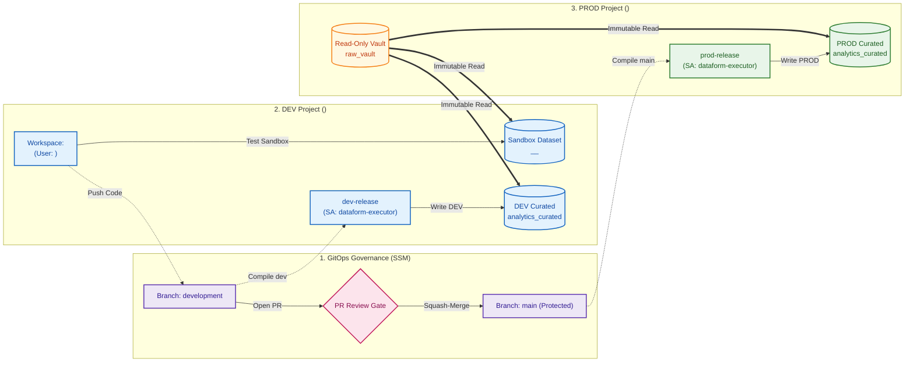

# Enterprise Secure Dataform ELT Pipeline with Secure Source Manager & Developer Connect

## Overview
This repository implements an enterprise Dataform ELT architecture spanning multiple isolated Google Cloud projects, integrated with **Secure Source Manager (SSM)** for GitOps governance and connected to **Google Cloud Dataform** using **Developer Connect with Git Proxy**.

---

## 📑 Navigation & Agenda

- [🏗️ Architecture & Environment Topology](#%EF%B8%8F-architecture--environment-topology)
- [📖 Demo Presentation Script](#-demo-presentation-script)
- [🚀 Deployment & Automation Suite](#-deployment--automation-suite)
  - [⚠️ Mandatory Step 0: Configure Environment (`config.env`)](#%EF%B8%8F-mandatory-step-0-configure-your-environment-configenv)
  - [🌟 Quick Start: Automated Deployment](#-quick-start-one-click-end-to-end-deployment)
  - [📜 Individual Deployment Scripts Catalog](#-step-by-step-individual-scripts)
- [🎬 Presenting & Resetting the Demo](#-presenting--resetting-the-demo)
- [📚 Appendix: Environment Mappings, IAM & Governance Reference](#-appendix-environment-mappings-iam--governance-reference)
  - [Key Environment Topology Mappings](#key-environment-mappings)
  - [Roles & Governance Capabilities Matrix](#roles--governance-capabilities-matrix)
  - [Security & Identity Bindings](#security--identity-bindings)

---

## 🏗️ Architecture & Environment Topology



### Environment Topology Summary
* **Central Git Governance (SSM)**: Hosted in `<ssm_project_id>` with branch protection requiring peer review and approvals before merging into `main`.
* **DEV Project (`<dev_project_id>`)**: Hosts developer workspaces with isolated sandbox datasets (`analytics_curated__<developer_workspace>`) and automated DEV release builds.
* **PROD Project (`<prod_project_id>`)**: Contains the immutable `raw_vault` data source and the production curated analytics tables.

> 💡 *For resource IDs, IAM bindings, and permission matrices, see the [Appendix](#-appendix-environment-mappings-iam--governance-reference) at the bottom.*

---

## 📖 Demo Presentation Script

* 📖 **[DEMO_SCRIPT.md](DEMO_SCRIPT.md)**: Master presentation guide containing word-for-word presenter narration, UI action steps, screenshot capture guides, and BigQuery enterprise audit proof queries.

---

## 🚀 Deployment & Automation Suite

> [!IMPORTANT]
> ### ⚠️ Mandatory Step 0: Configure Your Environment (`config.env`)
> **Before running the automated deployment or any script, you MUST open and edit [`config.env`](config.env) with your specific Google Cloud settings and demo persona:**
>
> ```bash
> # Open config.env in your editor:
> nano config.env
> ```
>
> **Key Parameters to Customize:**
> * `DEVELOPER`: The Google Cloud / Google Workspace email representing the developer persona (e.g. `your_user@example.com`).
> * `DEVELOPER_WORKSPACE`: Name of the developer's Dataform workspace (e.g. `developer`).
> * `LOCATION`: Target Google Cloud region for BigQuery, Dataform, and SSM (e.g. `me-west1`, `us-central1`).
> * `DEV_PROJECT_NAME`, `PROD_PROJECT_NAME`, `SSM_PROJECT_NAME`: Display prefixes for your 3 projects.
> * `BILLING_ID` *(optional)*: Your Cloud Billing Account ID (leave blank to auto-detect via `gcloud`).

---

### 🌟 Quick Start: One-Click End-to-End Deployment
Once `config.env` is configured with your settings, run the master deployment script to provision infrastructure, configure IAM, link SSM, and execute the baseline ELT pipeline:

```bash
./scripts/00_deploy_all.sh
```
*(This automatically runs Steps 01 through 10 in sequence with comprehensive validation and progress logging).*

---

### 📜 Step-by-Step Individual Scripts

| Script | Purpose & Description |
| :--- | :--- |
| **[`01_provision_projects.sh`](scripts/01_provision_projects.sh)** | Provisions 3 Google Cloud projects (`DEV`, `PROD`, `SSM`), links billing, and enables required GCP APIs. Dynamically resolves runtime project IDs. |
| **[`02_create_datasets.sh`](scripts/02_create_datasets.sh)** | Creates core BigQuery datasets in DEV and PROD (`raw_vault`, `analytics_curated`, `dataform_assertions`). |
| **[`03_seed_prod_data.sh`](scripts/03_seed_prod_data.sh)** | Populates raw synthetic transaction records into `<prod_project_id>.raw_vault.raw_transactions`. |
| **[`04_configure_iam_security.sh`](scripts/04_configure_iam_security.sh)** | Creates `dataform-executor` Service Account, grants least-privilege dataset ACLs, and configures impersonation roles. |
| **[`05_verify_security_boundaries.sh`](scripts/05_verify_security_boundaries.sh)** | Automated 5-test security suite verifying cross-project reads, DEV dataset accessibility, and write restriction enforcement. |
| **[`06_provision_secure_source_manager.sh`](scripts/06_provision_secure_source_manager.sh)** | Provisions SSM instance, creates Git repo, enforces `main` branch protection rule, and establishes Developer Connect Git Proxy. |
| **[`07_create_dataform_configs.sh`](scripts/07_create_dataform_configs.sh)** | Connects Dataform repository to SSM, creates developer workspace, and configures release & workflow executions. |
| **[`08_verify_ssm_pipeline.sh`](scripts/08_verify_ssm_pipeline.sh)** | Runs 6 automated checks validating SSM state, branch rules, Git proxy connectivity, and Dataform token health. |
| **[`09_execute_elt_pipeline.sh`](scripts/09_execute_elt_pipeline.sh)** | Compiles and materializes baseline staging views, fact tables, and quality assertions. |
| **[`10_verify_pipeline_and_assertions.sh`](scripts/10_verify_pipeline_and_assertions.sh)** | Verifies DAG compilation, source anti-hijacking resolution, staging cleansing, fact deduplication, and zero assertion failures. |
| **[`12_reset_demo_state.sh`](scripts/12_reset_demo_state.sh)** | Restores all environments, branches, and tables to pristine **v1.0 baseline** prior to live presentations. |

---

## 🎬 Presenting & Resetting the Demo

1. **Present Live via Google Cloud Console**:
   Follow the step-by-step narrative and talking points in [`DEMO_SCRIPT.md`](DEMO_SCRIPT.md).

2. **Reset to Baseline Anytime**:
   ```bash
   ./scripts/12_reset_demo_state.sh
   ```

### Web Console Shortcuts:
* **Secure Source Manager Console**:
  `https://<instance_id>-<project_number>.<region>.sourcemanager.dev/<ssm_project_id>/<repo_id>`
* **SSM Pull Requests**:
  `https://<instance_id>-<project_number>.<region>.sourcemanager.dev/<ssm_project_id>/<repo_id>/pulls`
* **Google Cloud Dataform Repositories**:
  `https://console.cloud.google.com/bigquery/dataform?project=<dev_project_id>`

---

## 📚 Appendix: Environment Mappings, IAM & Governance Reference

### Key Environment Mappings

| Environment Role | Project Context | Resource / Dataset | Governance Purpose |
| :--- | :--- | :--- | :--- |
| **Git Repository** | `<ssm_project_id>` | `dataform-pipeline` (SSM) | Private Secure Source Manager repository |
| **Developer Sandbox** | `<dev_project_id>` | `analytics_curated__<developer_workspace>` | Isolated developer testing sandbox (`schemaSuffix: _<developer_workspace>`) |
| **DEV Integration Target**| `<dev_project_id>` | `analytics_curated` | Automated DEV release target |
| **PROD Raw Source** | `<prod_project_id>` | `raw_vault.raw_transactions` | Immutable raw data source |
| **PROD Curated Target** | `<prod_project_id>` | `analytics_curated` | High-governance production tables |
| **Execution Identity** | `<dev_project_id>` | `dataform-executor@...` | Dedicated least-privilege pipeline Service Account |

---

### Roles & Governance Capabilities Matrix

| Capability / Action | Developer (`<developer_email>`) | Reviewer / Admin | Pipeline Service Account |
| :--- | :--- | :--- | :--- |
| **Workspace Development** (`workspaces/<developer_workspace>`) | Allowed | Denied *(Isolated per user)* | N/A |
| **Sandbox Execution** (`analytics_curated__<developer_workspace>`) | Allowed | Allowed | N/A |
| **Raw Data Access** (`raw_vault`) | Allowed *(Read-Only)* | Allowed *(Read-Only)* | Allowed *(Read-Only)* |
| **Push to Development Branch** (`development`) | Allowed | Allowed | N/A |
| **Push to Main Branch** (`main`) | Blocked *(Branch Protection)* | Blocked *(Branch Protection)* | N/A |
| **Open Pull Request** (`development` &rarr; `main`) | Allowed | Allowed | N/A |
| **Approve & Merge Pull Request** | Blocked *(Peer Review Required)* | Allowed | N/A |
| **Direct Write to Production** (`analytics_curated`) | Denied | Denied *(Service Account Only)* | Allowed *(Automated)* |
| **Direct Write to Shared DEV** (`analytics_curated`) | Denied *(Sandbox Only)* | Denied *(Release Managed)* | Allowed *(Automated)* |
| **Trigger Release Workflows** (`dev-release` / `prod-release`) | Denied | Allowed | Execution Identity |
| **Audit BigQuery Jobs** (`INFORMATION_SCHEMA`) | Self Only | Full Project Audit | Logged Principal |

#### Key Governance Boundaries:
* **Developer Persona**: Confined to private sandbox datasets and feature branches. Cannot write to production or self-approve PRs.
* **Reviewer / Admin**: Reviews code diffs, enforces quality gates, and triggers release pipelines. Cannot bypass peer reviews.
* **Pipeline Service Account (`dataform-executor`)**: The exclusive identity authorized to write to shared DEV and PROD datasets during automated workflow executions.

---

### Security & Identity Bindings

| Identity / Service Agent | Project Context | Granted Roles & Scope | Purpose |
| :--- | :--- | :--- | :--- |
| **Developer Connect SA** (`service-<dev_project_number>@gcp-sa-devconnect...`) | `<ssm_project_id>` (SSM) | `roles/securesourcemanager.developerConnectLinker`<br>`roles/securesourcemanager.instanceAccessor`<br>`roles/securesourcemanager.repoReader` | Allows Developer Connect in `<dev_project_id>` to securely bridge and clone from SSM instance |
| **Dataform Service Agent** (`service-<dev_project_number>@gcp-sa-dataform...`) | `<dev_project_id>` | `roles/developerconnect.gitProxyUser`<br>`roles/developerconnect.tokenAccessor`<br>`roles/developerconnect.viewer`<br>`roles/iam.serviceAccountUser` | Allows Dataform compiler to use Developer Connect's Git Proxy to pull code and run under executor SA |
| **Pipeline Service Account** (`dataform-executor@<dev_project_id>.iam...`) | `<dev_project_id>` & `<prod_project_id>` | `roles/bigquery.dataEditor`<br>`roles/bigquery.jobUser`<br>`roles/bigquery.dataViewer` (on `raw_vault`) | Dedicated execution identity for automated workflow invocations |
| **Developer Identity** (`<developer_email>`) | `<ssm_project_id>` & `<dev_project_id>` | `roles/securesourcemanager.repoWriter`<br>`roles/dataform.editor`<br>`roles/bigquery.dataEditor` (on `__<developer_workspace>`) | Allows developer to develop in private sandbox and push to `development` |
| **Protected Main Branch Rule** (`main-protection`) | SSM Repo: `dataform-pipeline` | `requirePullRequest: true`<br>`minimumReviewsCount: 1`<br>`requireLinearHistory: true` | Blocks direct unreviewed pushes to `main` |
