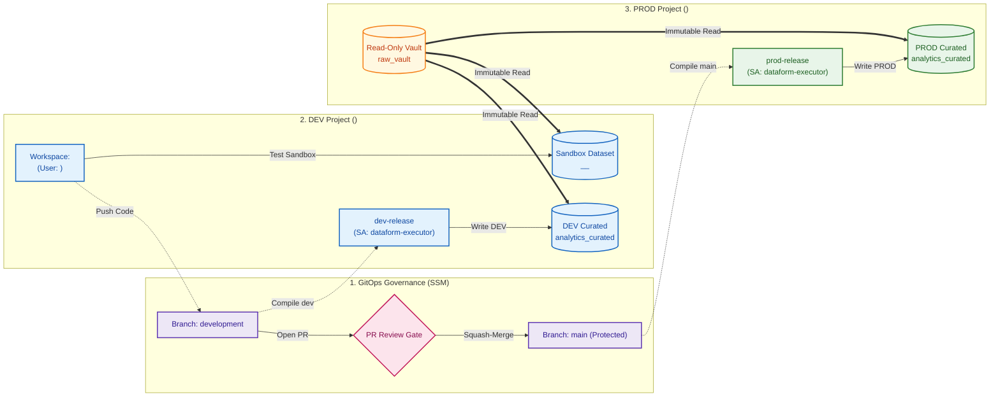

# Enterprise Secure Dataform ELT Pipeline with Secure Source Manager & Developer Connect

## Overview
This repository contains the enterprise Dataform ELT architecture spanning multiple Google Cloud projects, integrated with **Secure Source Manager (SSM)** hosted in an organization-level project (`<ssm_project_id>`) and connected to **Google Cloud Dataform** in `<dev_project_id>` and `<prod_project_id>` using **Developer Connect with Git Proxy**.

---

## 🏛️ Architecture & Environment Topology



### Key Environment Mappings
| Environment Role | Project ID | Dataset / Resource | Notes |
| :--- | :--- | :--- | :--- |
| **Git Repository** | `<ssm_project_id>` | `dataform-pipeline` (SSM) | Private Secure Source Manager repository |
| **Developer Sandbox** | `<dev_project_id>` | `analytics_curated__<developer_workspace>` | Isolated developer testing sandbox (`schemaSuffix: _<developer_workspace>`) |
| **DEV Integration Target**| `<dev_project_id>` | `analytics_curated` | Automated DEV release target |
| **PROD Raw Source** | `<prod_project_id>` | `raw_vault.raw_transactions` | Immutable raw data source |
| **PROD Curated Target** | `<prod_project_id>` | `analytics_curated` | High-governance production tables |
| **Execution Identity** | `<dev_project_id>` | `dataform-executor@...` | Dedicated least-privilege pipeline Service Account |

---

## 👥 Roles & Governance Capabilities Matrix

| Capability / Action | Developer (`<developer_email>`) | Reviewer / Admin | Pipeline Service Account |
| :--- | :---: | :---: | :---: |
| **Develop in workspace (`workspaces/<developer_workspace>`)** | ✅ **Allowed** | ❌ User-Isolated | ❌ N/A |
| **Execute in Sandbox (`analytics_curated__<developer_workspace>`)** | ✅ **Allowed** | ✅ Allowed | ❌ N/A |
| **Read raw data from PROD vault (`raw_vault`)** | ✅ **Allowed** (Read-Only) | ✅ Allowed (Read-Only) | ✅ **Allowed** (Read-Only) |
| **Push code directly to `development` branch** | ✅ **Allowed** | ✅ Allowed | ❌ N/A |
| **Push code directly to `main` branch** | 🛑 **Blocked** (Branch Rule) | 🛑 **Blocked** (Branch Rule) | ❌ N/A |
| **Open Pull Request (`development` $\rightarrow$ `main`)** | ✅ **Allowed** | ✅ Allowed | ❌ N/A |
| **Approve & Squash-Merge PR into `main`** | 🛑 **Blocked** (Needs Reviewer) | ✅ **Allowed** | ❌ N/A |
| **Directly write to PROD (`<prod_project_id>.analytics_curated`)** | 🛑 **No Permission** | 🛑 **No Manual Writes** | ✅ **Allowed** (Automated) |
| **Directly write to shared DEV target** | 🛑 **No Permission** *(Sandbox only)*| 🛑 **Managed by Release** | ✅ **Allowed** (Automated) |
| **Trigger DEV / PROD Workflow Configurations** | 🛑 **No Permission** | ✅ **Allowed** | ✅ **Execution Identity** |
| **Audit BigQuery Jobs (`INFORMATION_SCHEMA`)** | ❌ Limited to own jobs | ✅ Full project audit | ❌ Logged Identity |

---

## 📋 Security & Identity Bindings

| Identity / Service Agent | Project Context | Granted Roles & Scope | Purpose |
| :--- | :--- | :--- | :--- |
| **Developer Connect SA** (`service-<dev_project_number>@gcp-sa-devconnect...`) | `<ssm_project_id>` (SSM) | `roles/securesourcemanager.developerConnectLinker`<br>`roles/securesourcemanager.instanceAccessor`<br>`roles/securesourcemanager.repoReader` | Allows Developer Connect in `<dev_project_id>` to securely bridge and clone from SSM instance |
| **Dataform Service Agent** (`service-<dev_project_number>@gcp-sa-dataform...`) | `<dev_project_id>` | `roles/developerconnect.gitProxyUser`<br>`roles/developerconnect.tokenAccessor`<br>`roles/developerconnect.viewer` | Allows Dataform compiler to use Developer Connect's Git Proxy to pull code |
| **Pipeline Service Account** (`dataform-executor@<dev_project_id>.iam...`) | `<dev_project_id>` & `<prod_project_id>` | `roles/bigquery.dataEditor`<br>`roles/bigquery.jobUser`<br>`roles/bigquery.dataViewer` (on `raw_vault`) | Dedicated execution identity for automated workflow invocations |
| **Developer Identity** (`<developer_email>`) | `<ssm_project_id>` & `<dev_project_id>` | `roles/securesourcemanager.repoWriter`<br>`roles/dataform.editor`<br>`roles/bigquery.dataEditor` (on `__<developer_workspace>`) | Allows developer to develop in private sandbox and push to `development` |
| **Protected Main Branch Rule** (`main-protection`) | SSM Repo: `dataform-pipeline` | `requirePullRequest: true`<br>`minimumReviewsCount: 1`<br>`requireLinearHistory: true` | Blocks direct unreviewed pushes to `main` |

---

## 📚 Demo Guide & Presentation Material

* 📖 **[DEMO_SCRIPT.md](DEMO_SCRIPT.md)**: Master presentation guide and demo script containing word-for-word presenter narration, UI action steps, screenshot capture guides, and BigQuery enterprise audit proof queries.

---

## 🚀 Step-by-Step Deployment & Automation Scripts

All scripts are located in [`scripts/`](scripts/) and automatically source configuration parameters from the central [`config.env`](config.env) file at the project root:
- `DEV_PROJECT` (e.g. `<dev_project_id>`)
- `PROD_PROJECT` (e.g. `<prod_project_id>`)
- `SSM_PROJECT` (e.g. `<ssm_project_id>`)
- `LOCATION` (e.g. `<region>`)
- `DEVELOPER` (e.g. `<developer_email>`)
- `BILLING_ID`, `INSTANCE_ID`, `REPO_ID`, `CONN_ID`, etc.

### 🌟 Quick Start: One-Click End-to-End Deployment
To deploy and verify the entire environment from start to finish, run:
```bash
./scripts/00_deploy_all.sh
```
*(This automatically runs Steps 01 through 10 in sequence with full progress reporting).*

---

### Step-by-Step Individual Scripts

### 1. [`01_provision_projects.sh`](scripts/01_provision_projects.sh) *(Project Provisioning & API Activation)*
Provisions / validates all three Google Cloud projects (`DEV`, `PROD`, `SSM Host`), links active billing account, and enables all required Google Cloud APIs (`bigquery`, `dataform`, `securesourcemanager`, `developerconnect`, `iam`, `cloudresourcemanager`).

### 2. [`02_create_datasets.sh`](scripts/02_create_datasets.sh) *(Core Dataset Creation)*
Creates core BigQuery datasets in the configured region:
- `<prod_project_id>:raw_vault` (Locked source of truth)
- `<prod_project_id>:analytics_curated` & `dataform_assertions`
- `<dev_project_id>:analytics_curated` & `dataform_assertions`
*(Note: Developer sandbox datasets like `analytics_curated__<developer_workspace>` are created dynamically on-the-fly by Dataform upon first execution).*

### 3. [`03_seed_prod_data.sh`](scripts/03_seed_prod_data.sh) *(Data Seeding)*
Executes [`seed_raw_transactions.sql`](scripts/seed_raw_transactions.sql) to populate raw synthetic transactions in `<prod_project_id>.raw_vault.raw_transactions`.

### 4. [`04_configure_iam_security.sh`](scripts/04_configure_iam_security.sh) *(Service Accounts & Least-Privilege IAM)*
- Creates dedicated pipeline Service Account: `dataform-executor@<dev_project_id>.iam.gserviceaccount.com`.
- Initializes Dataform and Developer Connect Service Agents.
- Grants project-level BigQuery job user and Dataform editor roles.
- Configures least-privilege dataset ACLs: Read-only on `raw_vault` for developers and DEV agents; Editor on output curated datasets for SAs.

### 5. [`05_verify_security_boundaries.sh`](scripts/05_verify_security_boundaries.sh) *(Security Boundary Testing)*
Automated 5-test security suite verifying cross-project reads, DEV dataset accessibility, Dataform cross-project compilation, strict read-only enforcement on `raw_vault`, and negative security checks blocking write contamination.

### 6. [`06_provision_secure_source_manager.sh`](scripts/06_provision_secure_source_manager.sh) *(SSM, Branch Rules & Dev Connect)*
- Provisions SSM instance `df-source-instance` in `<ssm_project_id>`.
- Creates Git repository `dataform-pipeline` with default branch `development`.
- Configures SSM branch protection rule `main-protection` on `main` (requires Pull Request and 1 reviewer approval).
- Provisions Developer Connect connection `ssm-conn` with Git Proxy enabled.
- Links Developer Connect Git repository to Dataform.

### 7. [`07_create_dataform_configs.sh`](scripts/07_create_dataform_configs.sh) *(Dataform Repo, Workspaces & Release Configs)*
- Creates Dataform repository `dataform-pipeline` linked to Developer Connect Git Proxy.
- Creates developer workspace (e.g. `<developer_workspace>`).
- Creates release configs: `dev-release` (branch `development` $\rightarrow$ `<dev_project_id>`) and `prod-release` (branch `main` $\rightarrow$ `<prod_project_id>`).
- Creates workflow configs: `dev-execution` and `prod-execution` running under service account `dataform-executor`.

### 8. [`08_verify_ssm_pipeline.sh`](scripts/08_verify_ssm_pipeline.sh) *(SSM & Dev Connect Verification)*
Runs 6 automated tests validating SSM instance state, repository existence, branch protection rule, Developer Connect Git Proxy status, Dataform token access status (`VALID`), and release compilation.

### 9. [`09_execute_elt_pipeline.sh`](scripts/09_execute_elt_pipeline.sh) *(Baseline ELT Pipeline Execution)*
Compiles and materializes baseline tables in BigQuery:
- Cleansed staging view: `analytics_curated.stg_transactions`
- Curated partitioned & clustered fact table: `analytics_curated.fct_cleaned_transactions`
- Executes data quality assertion checks (`assert_unique_transaction_id`, `assert_positive_amounts`).

### 10. [`10_verify_pipeline_and_assertions.sh`](scripts/10_verify_pipeline_and_assertions.sh) *(Pipeline Quality Verification)*
5-test verification suite validating DAG compilation, source anti-hijacking resolution, staging cleansing, fact table deduplication, partitioning/clustering metadata, and assertion results.

### 11. [`12_reset_demo_state.sh`](scripts/12_reset_demo_state.sh) *(Hard Reset & Cleanup)*
Restores all environments, branches, and tables to pristine **v1.0 baseline**:
- Resets Git branches `main` and `development` back to baseline commit (without `customer_tier`).
- Re-enables SSM branch protection rule `main-protection`.
- Recreates developer workspace `<developer_workspace>` to eliminate Git merge conflicts.
- Cleans developer sandbox datasets (`analytics_curated__<developer_workspace>`).
- Materializes v1.0 baseline tables in DEV and PROD.

---

## 🎬 Presenting & Resetting the Demo

1. **Present Live via Google Cloud Console**:
   Follow the step-by-step narrative and talking points in [`DEMO_SCRIPT.md`](DEMO_SCRIPT.md).

2. **Reset to Baseline Anytime**:
   ```bash
   ./scripts/12_reset_demo_state.sh
   ```

### Web Console Shortcuts:
* **Secure Source Manager Console**:
  `https://<instance_id>-<project_number>.<region>.sourcemanager.dev/<ssm_project_id>/<repo_id>`
* **SSM Pull Requests**:
  `https://<instance_id>-<project_number>.<region>.sourcemanager.dev/<ssm_project_id>/<repo_id>/pulls`
* **Google Cloud Dataform Repositories**:
  `https://console.cloud.google.com/bigquery/dataform?project=<dev_project_id>`
